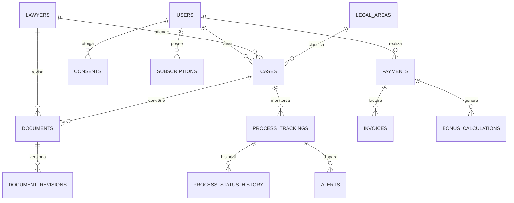

# Consultorio Digital Legal — Modelo de Datos (PostgreSQL)

> Esquema transaccional v1. Convenciones: UUID como PK, `created_at`/`updated_at` con trigger, soft-delete solo donde se exige retención legal (no borrar datos de facturación/auditoría).
> Los **documentos y evidencia** van a S3 (cifrado AES-256); en BD solo se guarda la referencia (`storage_key`).

---

## 1. Diagrama Entidad-Relación (resumen)



---

## 2. Esquema por dominio

### 2.1 Identidad y accesos (RBAC)

```sql
CREATE TABLE users (
  id              UUID PRIMARY KEY DEFAULT gen_random_uuid(),
  email           TEXT UNIQUE NOT NULL,
  phone           TEXT,
  full_name       TEXT NOT NULL,
  document_type   TEXT NOT NULL,            -- CC, CE, NIT, TI, PAS
  document_number TEXT NOT NULL,
  role            TEXT NOT NULL DEFAULT 'client', -- client|lawyer|admin|auditor
  status          TEXT NOT NULL DEFAULT 'active', -- active|suspended|deleted
  mfa_enabled     BOOLEAN NOT NULL DEFAULT false,
  last_login_at   TIMESTAMPTZ,
  created_at      TIMESTAMPTZ NOT NULL DEFAULT now(),
  updated_at      TIMESTAMPTZ NOT NULL DEFAULT now(),
  UNIQUE (document_type, document_number)
);

CREATE TABLE lawyers (
  id                  UUID PRIMARY KEY DEFAULT gen_random_uuid(),
  user_id             UUID NOT NULL REFERENCES users(id) ON DELETE CASCADE,
  tarjeta_profesional TEXT UNIQUE NOT NULL,
  verification_status TEXT NOT NULL DEFAULT 'pending', -- pending|verified|rejected
  verified_at         TIMESTAMPTZ,
  bio                 TEXT,
  availability        JSONB,                 -- { "schedule": [...], "active": true }
  created_at          TIMESTAMPTZ NOT NULL DEFAULT now()
);

CREATE TABLE legal_areas (                   -- catálogo: penal, civil, laboral, familia, administrativo...
  id        UUID PRIMARY KEY DEFAULT gen_random_uuid(),
  code      TEXT UNIQUE NOT NULL,            -- "penal", "laboral"...
  name      TEXT NOT NULL,
  is_active BOOLEAN NOT NULL DEFAULT true
);

CREATE TABLE lawyer_specialties (            -- N:M abogado <-> rama
  lawyer_id UUID NOT NULL REFERENCES lawyers(id) ON DELETE CASCADE,
  area_id   UUID NOT NULL REFERENCES legal_areas(id) ON DELETE CASCADE,
  PRIMARY KEY (lawyer_id, area_id)
);

-- Tablas de auditoría de accesos (RBAC + trazabilidad)
CREATE TABLE audit_logs (
  id         UUID PRIMARY KEY DEFAULT gen_random_uuid(),
  actor_id   UUID,                            -- usuario que actuó (nullable si es sistema)
  action     TEXT NOT NULL,                   -- "login", "case.view", "document.approve"
  entity     TEXT NOT NULL,                   -- "case", "document"...
  entity_id  UUID,
  changes    JSONB,                           -- diff sin datos sensibles
  ip         INET,
  created_at TIMESTAMPTZ NOT NULL DEFAULT now()
);
```

### 2.2 Consentimiento y cumplimiento (Ley 1581)

```sql
CREATE TABLE privacy_policy_versions (
  id         UUID PRIMARY KEY DEFAULT gen_random_uuid(),
  version    INT  NOT NULL UNIQUE,
  content    TEXT NOT NULL,
  active_at  TIMESTAMPTZ NOT NULL
);

CREATE TABLE consents (
  id                 UUID PRIMARY KEY DEFAULT gen_random_uuid(),
  user_id            UUID NOT NULL REFERENCES users(id),
  policy_version_id  UUID NOT NULL REFERENCES privacy_policy_versions(id),
  purpose            TEXT NOT NULL,          -- "tratamiento", "envio_ia_terceros", "notificaciones"
  granted            BOOLEAN NOT NULL,
  granted_at         TIMESTAMPTZ NOT NULL DEFAULT now(),
  ip                 INET,
  channel            TEXT                     -- "web", "app"
);

CREATE TABLE data_subject_requests (         -- ejercicio de derechos ARCO (Acceso, Rectificación, Cancelación, Oposición)
  id         UUID PRIMARY KEY DEFAULT gen_random_uuid(),
  user_id    UUID NOT NULL REFERENCES users(id),
  type       TEXT NOT NULL,                  -- access|rectification|deletion|opposition
  status     TEXT NOT NULL DEFAULT 'open',   -- open|in_progress|completed|rejected
  response_due_at TIMESTAMPTZ NOT NULL,      -- Ley 1581: plazos máximos de respuesta
  created_at TIMESTAMPTZ NOT NULL DEFAULT now()
);
```

### 2.3 Casos y consultas

```sql
CREATE TABLE cases (
  id             UUID PRIMARY KEY DEFAULT gen_random_uuid(),
  client_user_id UUID NOT NULL REFERENCES users(id),
  lawyer_id      UUID REFERENCES lawyers(id),
  area_id        UUID NOT NULL REFERENCES legal_areas(id),
  status         TEXT NOT NULL DEFAULT 'open', -- open|in_review|in_progress|closed|cancelled
  priority       TEXT NOT NULL DEFAULT 'normal', -- low|normal|high|urgent
  summary        TEXT,                          -- resumen sin datos sensibles
  source         TEXT NOT NULL DEFAULT 'web',   -- web|chatbot|whatsapp
  created_at     TIMESTAMPTZ NOT NULL DEFAULT now(),
  updated_at     TIMESTAMPTZ NOT NULL DEFAULT now()
);

CREATE TABLE case_status_history (
  id         UUID PRIMARY KEY DEFAULT gen_random_uuid(),
  case_id    UUID NOT NULL REFERENCES cases(id) ON DELETE CASCADE,
  from_status TEXT,
  to_status  TEXT NOT NULL,
  changed_by UUID REFERENCES users(id),
  created_at TIMESTAMPTZ NOT NULL DEFAULT now()
);

CREATE TABLE consultations (               -- mensajes de la consulta (chatbot + abogado)
  id         UUID PRIMARY KEY DEFAULT gen_random_uuid(),
  case_id    UUID NOT NULL REFERENCES cases(id) ON DELETE CASCADE,
  author_id  UUID NOT NULL REFERENCES users(id),
  body       TEXT NOT NULL,
  kind       TEXT NOT NULL DEFAULT 'message', -- message|system|classification
  created_at TIMESTAMPTZ NOT NULL DEFAULT now()
);
```

### 2.4 Documentos y flujo de revisión

```sql
CREATE TABLE document_templates (
  id            UUID PRIMARY KEY DEFAULT gen_random_uuid(),
  area_id       UUID REFERENCES legal_areas(id),
  type          TEXT NOT NULL,             -- "tutela", "derecho_peticion", "contrato_arrendamiento", "liquidacion_alimentos"
  version       INT  NOT NULL,
  content       TEXT NOT NULL,             -- plantilla con placeholders {{...}}
  validated_by  UUID REFERENCES lawyers(id),
  validated_at  TIMESTAMPTZ,
  is_active     BOOLEAN NOT NULL DEFAULT true,
  UNIQUE (type, version)
);

CREATE TABLE documents (
  id             UUID PRIMARY KEY DEFAULT gen_random_uuid(),
  case_id        UUID NOT NULL REFERENCES cases(id),
  template_id    UUID REFERENCES document_templates(id),
  status         TEXT NOT NULL DEFAULT 'draft', -- draft|pending_review|approved|rejected|delivered|signed
  storage_key    TEXT,                          -- referencia al archivo en S3 (cifrado)
  signature_type TEXT,                          -- none|simple|digital
  generated_by   TEXT,                          -- "ia" | "abogado"
  created_at     TIMESTAMPTZ NOT NULL DEFAULT now()
);

CREATE TABLE document_revisions (
  id            UUID PRIMARY KEY DEFAULT gen_random_uuid(),
  document_id   UUID NOT NULL REFERENCES documents(id) ON DELETE CASCADE,
  version       INT  NOT NULL,
  storage_key   TEXT NOT NULL,
  reviewed_by   UUID REFERENCES lawyers(id),
  reviewed_at   TIMESTAMPTZ,
  review_status TEXT NOT NULL DEFAULT 'pending', -- pending|approved|rejected
  comments      TEXT,
  created_at    TIMESTAMPTZ NOT NULL DEFAULT now()
);
```

### 2.5 Pagos, suscripciones, facturación y bonos

```sql
CREATE TABLE plans (
  id             UUID PRIMARY KEY DEFAULT gen_random_uuid(),
  code           TEXT UNIQUE NOT NULL,      -- "pay_per_consult", "monthly_basic", "prepaid_tokens"
  name           TEXT NOT NULL,
  price_cents    BIGINT NOT NULL,
  currency       TEXT NOT NULL DEFAULT 'COP',
  interval       TEXT,                      -- one_time|monthly|yearly
  is_active      BOOLEAN NOT NULL DEFAULT true
);

CREATE TABLE subscriptions (
  id          UUID PRIMARY KEY DEFAULT gen_random_uuid(),
  user_id     UUID NOT NULL REFERENCES users(id),
  plan_id     UUID NOT NULL REFERENCES plans(id),
  status      TEXT NOT NULL DEFAULT 'active', -- active|past_due|cancelled|expired
  started_at  TIMESTAMPTZ NOT NULL DEFAULT now(),
  ends_at     TIMESTAMPTZ,
  gateway_ref TEXT
);

CREATE TABLE payments (
  id            UUID PRIMARY KEY DEFAULT gen_random_uuid(),
  user_id       UUID NOT NULL REFERENCES users(id),
  amount_cents  BIGINT NOT NULL,
  currency      TEXT NOT NULL DEFAULT 'COP',
  gateway       TEXT NOT NULL,              -- wompi|stripe|payu
  gateway_ref   TEXT UNIQUE,                -- referencia tokenizada (NUNCA el PAN)
  status        TEXT NOT NULL DEFAULT 'pending', -- pending|succeeded|failed|refunded
  created_at    TIMESTAMPTZ NOT NULL DEFAULT now()
);

CREATE TABLE invoices (                     -- facturación electrónica DIAN
  id            UUID PRIMARY KEY DEFAULT gen_random_uuid(),
  payment_id    UUID NOT NULL REFERENCES payments(id),
  cufe          TEXT UNIQUE,                -- Código Único de Facturación Electrónica
  xml_ref       TEXT,                       -- referencia al XML firmado
  status        TEXT NOT NULL DEFAULT 'draft', -- draft|validated|accepted|rejected
  issued_at     TIMESTAMPTZ
);

CREATE TABLE bonus_rules (                  -- regla configurable 60% objetivos + 40% cualitativos
  id         UUID PRIMARY KEY DEFAULT gen_random_uuid(),
  code       TEXT UNIQUE NOT NULL,
  formula    JSONB NOT NULL,                -- { "objective_weight": 0.6, "qualitative_weight": 0.4 }
  is_active  BOOLEAN NOT NULL DEFAULT true
);

CREATE TABLE bonus_calculations (
  id           UUID PRIMARY KEY DEFAULT gen_random_uuid(),
  lawyer_id    UUID NOT NULL REFERENCES lawyers(id),
  period_start DATE NOT NULL,
  period_end   DATE NOT NULL,
  result_cents BIGINT NOT NULL,
  breakdown    JSONB NOT NULL,              -- desglose auditable del cálculo
  created_at   TIMESTAMPTZ NOT NULL DEFAULT now()
);
```

### 2.6 Monitoreo de procesos, scraping y alertas

```sql
CREATE TABLE scrape_sources (
  id        UUID PRIMARY KEY DEFAULT gen_random_uuid(),
  name      TEXT NOT NULL,                  -- "rama_judicial_tyba", "rues", ...
  base_url  TEXT NOT NULL,
  status    TEXT NOT NULL DEFAULT 'active',
  last_ok_at TIMESTAMPTZ
);

CREATE TABLE process_trackings (            -- seguimiento de un proceso judicial
  id             UUID PRIMARY KEY DEFAULT gen_random_uuid(),
  case_id        UUID NOT NULL REFERENCES cases(id),
  source_id      UUID NOT NULL REFERENCES scrape_sources(id),
  radicado       TEXT NOT NULL,             -- número de radicado/NUNC
  last_status    TEXT,
  last_checked_at TIMESTAMPTZ,
  is_authoritative BOOLEAN NOT NULL DEFAULT false, -- scraping NUNCA es autoritativo
  created_at     TIMESTAMPTZ NOT NULL DEFAULT now()
);

CREATE TABLE process_status_history (       -- historial de estados detectados
  id             UUID PRIMARY KEY DEFAULT gen_random_uuid(),
  tracking_id    UUID NOT NULL REFERENCES process_trackings(id) ON DELETE CASCADE,
  status_snapshot JSONB NOT NULL,           -- snapshot crudo (referenciado, sin datos de terceros)
  diff           JSONB,                     -- diferencia vs. estado anterior
  detected_at    TIMESTAMPTZ NOT NULL DEFAULT now()
);

CREATE TABLE scrape_jobs (                  -- trabajos de scraping (colas)
  id         UUID PRIMARY KEY DEFAULT gen_random_uuid(),
  source_id  UUID NOT NULL REFERENCES scrape_sources(id),
  query_params JSONB,
  status     TEXT NOT NULL DEFAULT 'queued', -- queued|running|success|failed|needs_manual
  attempts   INT NOT NULL DEFAULT 0,
  error      TEXT,
  started_at TIMESTAMPTZ,
  finished_at TIMESTAMPTZ
);

CREATE TABLE alerts (
  id           UUID PRIMARY KEY DEFAULT gen_random_uuid(),
  user_id      UUID NOT NULL REFERENCES users(id),
  tracking_id  UUID REFERENCES process_trackings(id),
  channel      TEXT NOT NULL,               -- email|whatsapp|push
  status       TEXT NOT NULL DEFAULT 'queued', -- queued|sent|failed
  sent_at      TIMESTAMPTZ
);
```

### 2.7 Notificaciones

```sql
CREATE TABLE notifications (
  id         UUID PRIMARY KEY DEFAULT gen_random_uuid(),
  user_id    UUID NOT NULL REFERENCES users(id),
  channel    TEXT NOT NULL,
  template   TEXT NOT NULL,                 -- identificador de plantilla
  payload    JSONB NOT NULL,                -- SIN datos sensibles
  status     TEXT NOT NULL DEFAULT 'queued',
  created_at TIMESTAMPTZ NOT NULL DEFAULT now()
);
```

---

## 3. Reglas de integridad y retención

1. **Soft-delete** en `users` (no borrar físico); **retención** de `audit_logs`, `payments`, `invoices` (obligación contable/tributaria).
2. **Datos sensibles** nunca en `notifications.payload` ni en `alerts`; solo referencias + resumen.
3. **Documentos** en S3 cifrado; `storage_key` nunca expone datos del contenido.
4. **Cada cambio de estado** de `cases` y `documents` genera fila en `case_status_history` / `document_revisions`.
5. **Índices sugeridos:** `cases(client_user_id, status)`, `cases(lawyer_id)`, `documents(case_id, status)`, `payments(user_id, created_at)`, `audit_logs(actor_id, created_at)`, `process_trackings(case_id)`.
6. **Particionado futuro** (cuando crezca): `audit_logs` y `notifications` por rango de fecha.

---

*Próximo documento: `03-flujos-clave.md` (onboarding + consentimiento, clasificación, generación con revisión humana, pago, scraping + alerta).*
